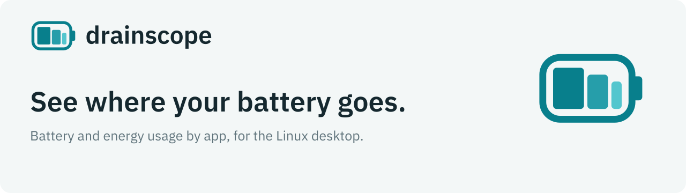
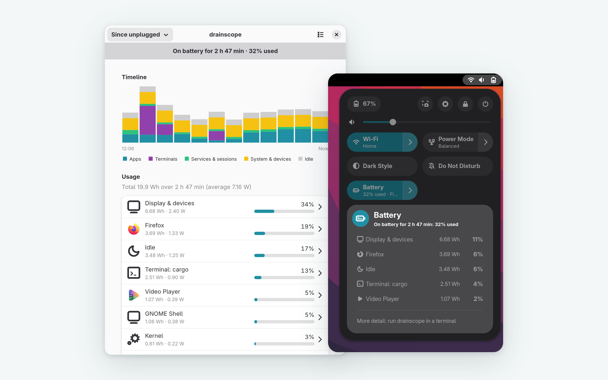
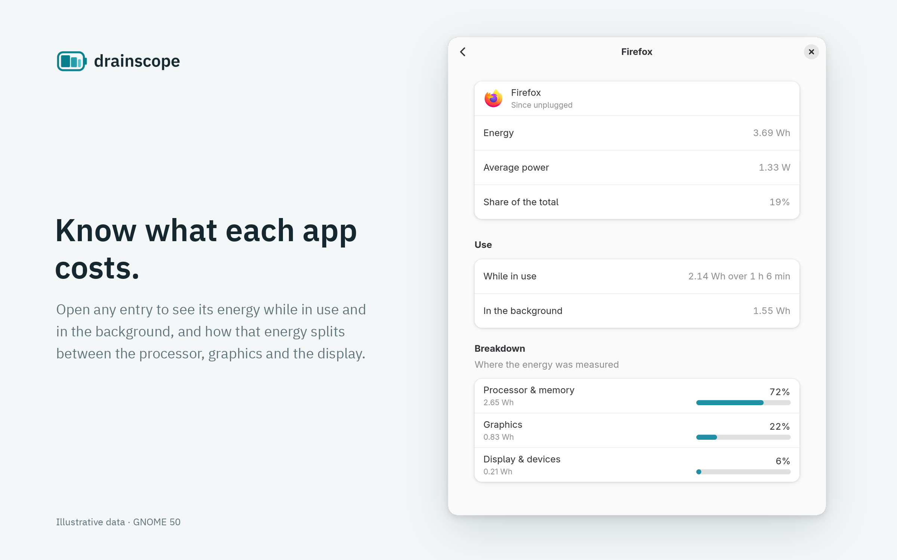
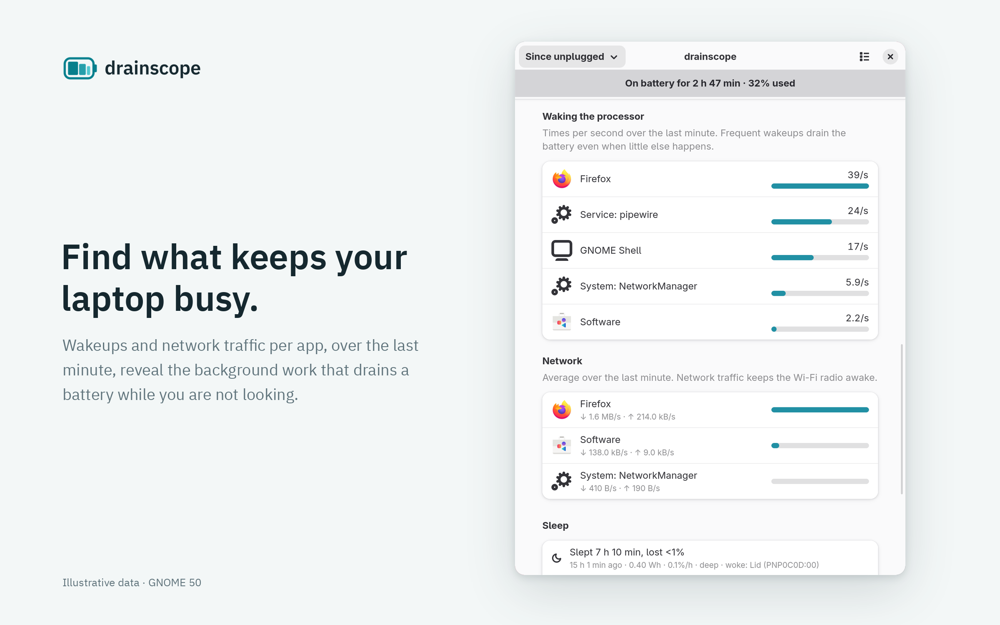
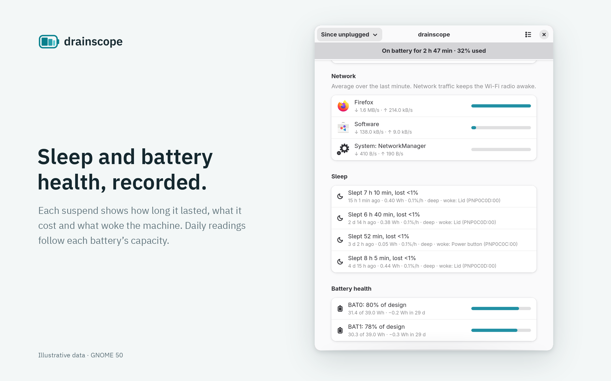
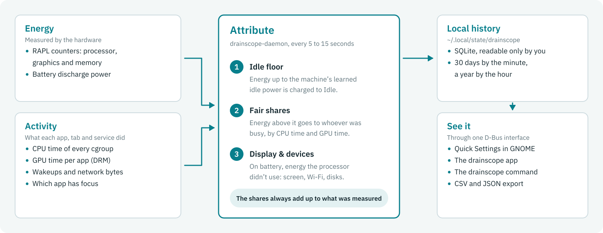

<picture>
  <source media="(prefers-color-scheme: dark)" srcset="branding/exports/social/readme-header-dark.svg">
  
</picture>

<p align="center">
  <a href="https://github.com/KhaledSaeed18/drainscope/releases/latest"></a>
  <a href="https://copr.fedorainfracloud.org/coprs/khaledsaeed18/drainscope/"></a>
  
  <a href="https://github.com/KhaledSaeed18/drainscope/actions/workflows/ci.yml"></a>
  <a href="LICENSE"></a>
</p>

**"Firefox used 14% of your battery since you unplugged."** Windows, macOS and Android have told you this for years. drainscope brings it to Linux.

drainscope measures the energy your laptop actually uses, from the processor's own energy counters and from the battery. It splits that energy between your apps, terminal tabs and system services, and shows the result in GNOME's Quick Settings, in a desktop app and on the command line. Your history stays on your machine, and nothing runs as root.

<picture>
  <source media="(prefers-color-scheme: dark)" srcset="branding/screenshots/exports/hero-dark.png">
  
</picture>

<p align="center"><sub>Screenshots use illustrative data.</sub></p>

## Features

- **Per-app battery use.** See every app, terminal command and service's share since you unplugged, over the last hour, 24 hours or 7 days.
- **In use or in the background.** See how much each app used while you were using it and how much while it ran in the background.
- **What keeps your laptop busy.** See which apps wake the processor from idle most often and how much network traffic each one sends and receives.
- **Sleep and battery health.** See the battery lost in each suspend and what woke the machine, plus each battery's capacity and wear over time.
- **Measured, not guessed.** drainscope uses hardware energy counters and the battery itself, with a documented model and [published accuracy](docs/validation.md).
- **Private and light.** Your history stays local and nothing uses the network. The daemon uses about 0.2% of one CPU while you aren't looking at it.

<picture>
  <source media="(prefers-color-scheme: dark)" srcset="branding/screenshots/exports/features/detail-dark.png">
  
</picture>

<picture>
  <source media="(prefers-color-scheme: dark)" srcset="branding/screenshots/exports/features/activity-dark.png">
  
</picture>

<picture>
  <source media="(prefers-color-scheme: dark)" srcset="branding/screenshots/exports/features/sleep-health-dark.png">
  
</picture>

## On the command line

```console
$ drainscope
On battery for 1 h 12 min: 18% of the battery used.

Consumer                 Battery  Of active use    Energy
──────────────────────────────────────────────────────────
Display & devices            11%              —   4.62 Wh
Idle                          4%              —   1.71 Wh
Firefox                       2%            61%   0.84 Wh
Terminal: pnpm               <1%            17%   0.23 Wh
GNOME Shell                  <1%             9%   0.12 Wh
…
```

| Command | Shows |
|---|---|
| `drainscope` | Battery used since you unplugged, by consumer |
| `drainscope report --since 24h` | Energy over a period, split into in use and in the background |
| `drainscope top` | Live power per consumer |
| `drainscope sleep` | Battery lost in each suspend, and what woke the machine |
| `drainscope wakeups` · `network` | Which apps wake the processor from idle, and their network traffic (with the optional probe) |
| `drainscope health` | Battery wear: full-charge capacity against design, and charge cycles |
| `drainscope doctor` | What can be measured on this machine, and how to fix what can't |

Add `--format csv` or `--format json` to export, e.g. `drainscope report --since 7d --format csv > week.csv`.

## Install

On Fedora 44, 45 or rawhide:

```bash
sudo dnf copr enable khaledsaeed18/drainscope
sudo dnf install drainscope drainscope-sampler drainscope-probe drainscope-app gnome-shell-extension-drainscope
systemctl --user enable --now drainscope.service
drainscope doctor
```

Log out and back in, then turn on the extension in the Extensions app (or run `gnome-extensions enable drainscope@khaledsaeed18.github.io`). The desktop app is **drainscope** in the app grid. Updates arrive through `dnf upgrade`.

For the release RPMs, building from source, or removing drainscope, see [Installing](docs/install.md).

## Hardware

| | |
|---|---|
| **Intel laptops** with RAPL and i915 graphics | Developed and [validated](docs/validation.md) on this hardware |
| **AMD Zen laptops** with amdgpu | Expected to work, but not yet tested on real hardware. Integrated-GPU energy is split by CPU time |
| **Intel xe driver** (Lunar Lake and newer) | Works, but GPU energy isn't split per app yet |
| **No RAPL** (virtual machines, some ARM laptops) | Battery readings split by CPU time |

`drainscope doctor` tells you which case applies to your machine.

## How it works

<picture>
  <source media="(prefers-color-scheme: dark)" srcset="docs/images/how-it-works-dark.svg">
  
</picture>

A small user service, `drainscope-daemon`, reads what each cgroup did, GPU time from the graphics driver, and the batteries. The processor's energy counters are root-only, so a tiny sandboxed system service reads them on the daemon's behalf. An optional eBPF service counts wakeups and network bytes. Each window's energy is split by a transparent model with no machine learning, and the shares always add up to what was measured.

**[Read the architecture →](docs/architecture.md)**

## Privacy and security

- **Local only.** No component opens a network socket, and your history is a file only you can read.
- **No root.** The two system services run as their own users with only the Linux capabilities they need (one for the sampler, three for the probe). systemd sandboxes them, and SELinux confines them where it's enabled.
- **Only the person at the machine.** polkit lets only the active local session read the counters, and readings are rate-limited and coarsened against the [Platypus](https://platypusattack.com/) side channel.
- **Only app IDs.** With the extension, drainscope records which app had focus, by app ID only, never window titles.

## Help

Run `drainscope doctor`. It checks every part and says what to do about anything that's missing. Common problems and fixes are listed under [Troubleshooting](docs/troubleshooting.md). Bugs and ideas go to [issues](https://github.com/KhaledSaeed18/drainscope/issues).

## Contributing

drainscope is written in Rust (daemons and CLI) and TypeScript (the GNOME Shell extension and the GTK app). See [Contributing](CONTRIBUTING.md) to build it, run the tests and send changes.

## License

[GPL-3.0-or-later](LICENSE)
