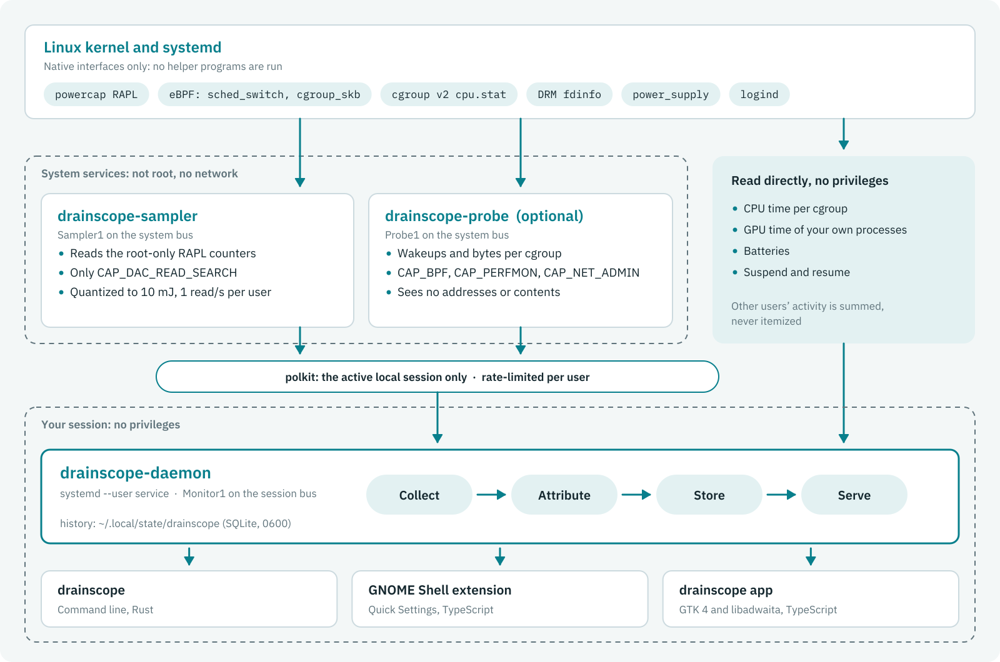
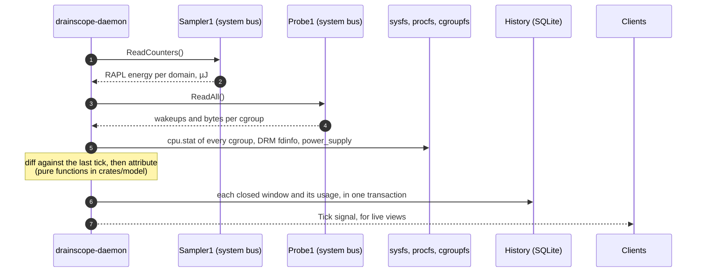
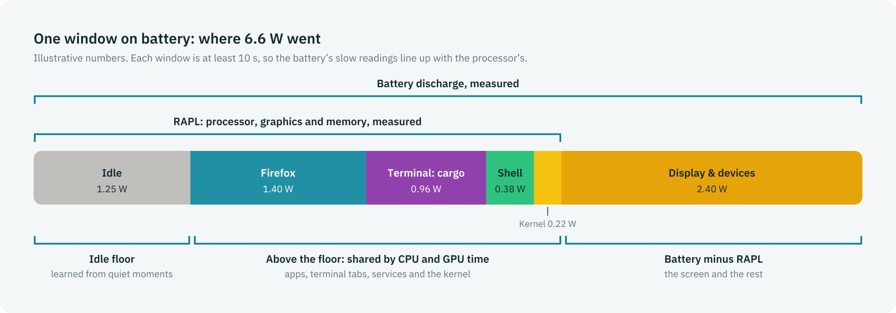
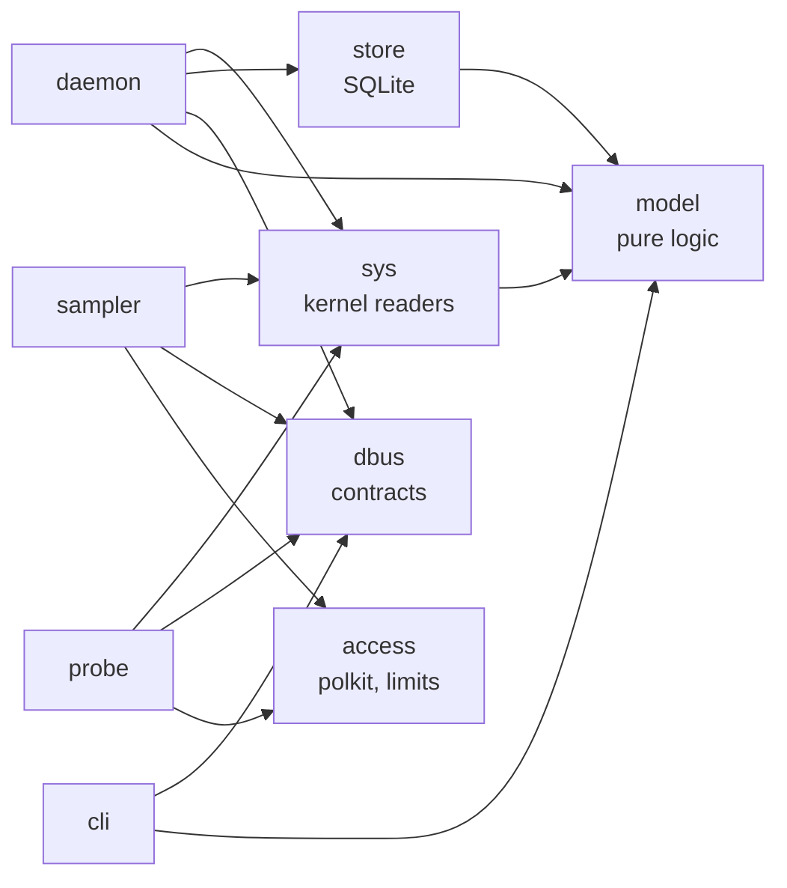

# Architecture

drainscope answers one question: *where did my battery go?* To answer it, drainscope measures energy, works out what each app did while that energy was used, and shares the energy out in proportion. This page covers how the parts fit together, what each one is allowed to do, and where the code lives.

**On this page:** [Components](#components) · [One tick](#one-tick) · [Attribution](#attribution) · [Consumers](#consumers) · [History](#history) · [D-Bus interfaces](#d-bus-interfaces) · [Security](#security) · [Code layout](#code-layout) · [Accuracy and cost](#accuracy-and-cost) · [Design records](#design-records)

## Components

<picture>
  <source media="(prefers-color-scheme: dark)" srcset="images/architecture-dark.svg">
  
</picture>

| Part | Runs as | Does |
|---|---|---|
| `drainscope-sampler` | System user `drainscope-sampler`, with only `CAP_DAC_READ_SEARCH` | Reads the RAPL energy counters, which are root-only, and serves them as `Sampler1` on the system bus. It is D-Bus activated and exits after 60 s without callers. |
| `drainscope-probe` (optional) | System user `drainscope-probe`, with only `CAP_BPF`, `CAP_PERFMON` and `CAP_NET_ADMIN`, in an empty network namespace | Counts with eBPF how often each cgroup wakes a CPU from idle (`sched_switch`) and the bytes each one sends and receives (`cgroup_skb`). It serves per-cgroup totals as `Probe1`, and starts and stops like the sampler. |
| `drainscope-daemon` | You, as a `systemd --user` service, with no privileges | Collects, attributes and stores every tick, and serves `Monitor1` on the session bus. One daemon per history file, enforced with a lock. |
| `drainscope` | You | The command line. It talks only to `Monitor1`. |
| GNOME Shell extension | You, inside GNOME Shell | The Battery menu in Quick Settings. It also tells the daemon which app has focus. |
| `drainscope-app` | You | The GTK 4 and libadwaita app: timelines, per-app detail, activity, sleep and battery health. |

Every part reads kernel and D-Bus interfaces directly. None of them runs helper programs such as `upower`, `ps` or `powertop`, or parses their output.

## One tick

The daemon ticks every 15 s, and every 5 s while the app or the Quick Settings menu is open. The tick is the daemon's main cost, so it slows down when nobody is looking.



- **Clocks.** Intervals use `CLOCK_MONOTONIC`, which stops during suspend, so a suspend never counts as usage. Suspends are recorded separately, from logind's `PrepareForSleep` signal and a delay inhibitor.
- **Windows.** The battery's power reading lags load changes by several seconds, so attribution reconciles the battery against RAPL over windows of at least 10 s.
- **Degraded modes.** Without the sampler, the daemon splits battery readings by CPU time. Without the probe, the network step is skipped. Without a battery, it uses RAPL alone. `drainscope doctor` and `Monitor1.Status` say which mode is in effect.

## Attribution

<picture>
  <source media="(prefers-color-scheme: dark)" srcset="images/attribution-dark.svg">
  
</picture>

For each window, the model in `crates/model` does the following:

1. **Splits RAPL into parts:** `core`, `uncore` (the integrated GPU), the rest of the package, and `dram`.
2. **Charges each part's idle floor to Idle.** The floor is the median power of quiet intervals. It is learned over the machine's whole history, separately on battery and on AC.
3. **Shares the energy above the floor by activity.** The GPU part is shared by GPU time from DRM fdinfo, and the other parts by CPU time from each cgroup's `cpu.stat`. Kernel time counts as its own consumer.
4. **Moves network work to apps** (model v2 and v3). The kernel's network softirq time and the network interrupt threads go to cgroups in proportion to the bytes the probe counted.
5. **Charges the rest of the battery to Display & devices.** On battery, battery energy minus RAPL energy is the screen, Wi-Fi, disks and the rest of the board. No conversion factor is applied between the two sensors ([ADR 0004](adr/0004-no-conversion-factor.md)).

The shares always add up to the measured energy, and property tests check that. Every stored window carries the `model_version` that produced it, so a new model never reinterprets old history. The current model is v4. The full specification, with known limitations, is in [the attribution model](attribution-model.md).

## Consumers

Cgroup paths become consumers by the identity rules in `crates/model`:

| cgroup | Consumer | Shown as |
|---|---|---|
| `app.slice/app-gnome-<app id>-<pid>.scope`, `app-flatpak-…`, D-Bus-activated apps | `app:<app id>` | The app's name and icon |
| `app.slice/vte-spawn-<uuid>.scope`, `ptyxis-spawn-…` | `term:<command>` | Terminal: cargo |
| `session.slice/org.gnome.Shell@wayland.service` | `shell` | GNOME Shell |
| `user@<uid>.service/…/<unit>.service` | `user-unit:<unit>` | User service: pipewire |
| `system.slice/<unit>.service` | `unit:<unit>` | System: NetworkManager |
| `user.slice/user-<uid>.slice/session-<id>.scope` | `session:<id>` | The session's leader (sudo, ssh, a tty) |
| Another user's `user-<uid>.slice` | `other-users` | Other users, summed and never itemized |
| CPU time outside every cgroup | `kernel` | Kernel |
| The learned floor; battery minus RAPL | `idle`; `devices` | Idle; Display & devices |

drainscope's own processes are a consumer too, so its cost shows up like any other's.

## History

The daemon stores history in SQLite at `~/.local/state/drainscope/drainscope.db`. The file is created with mode `0600` and written in WAL mode. Schema changes are numbered migrations.

| Data | Kept for |
|---|---|
| Windows and per-consumer usage, at full resolution | 48 hours |
| Per-minute totals | 30 days |
| Per-hour totals | 1 year |
| Which app had focus (app IDs only) | Like usage: 48 hours, then by the minute and by the hour |
| Plug and unplug events, suspends | 1 year |
| Battery health readings | Not pruned |

The daemon writes the minute and hour totals in the same transaction as each window, so the totals always equal the raw data, and a property test checks it. Pruning only deletes. A query reads the finest resolution that still covers its range.

## D-Bus interfaces

The introspection XML in [`data/dbus/interfaces/`](../data/dbus/interfaces/) is authoritative. Interfaces are versioned by name, and changes within a version only add.

| Interface | Bus | Methods |
|---|---|---|
| `io.github.khaledsaeed18.Drainscope.Sampler1` | system | `ReadCounters` |
| `io.github.khaledsaeed18.Drainscope.Probe1` | system | `ReadAll`, `ReadWakeups`, `ReadNetwork`, `ReadNetworkTime` |
| `io.github.khaledsaeed18.Drainscope.Monitor1` | session | `GetSummary`, `GetUsage`, `GetCoverage`, `GetSleepSessions`, `GetSleepHistory`, `GetBatteryHealth`, `GetWakeups`, `GetNetwork`, `SetFocus`, `EndFocus`, `GetFocus`, and the `Tick` signal |

Because the clients only use `Monitor1`, a new front end, such as a KDE Plasma widget, needs no changes to the daemon.

## Security

- **Nothing runs as root.** The sampler and the probe are static system users created by `sysusers.d` ([ADR 0003](adr/0003-static-sampler-user.md), [ADR 0006](adr/0006-ebpf-probe-service.md)). Each has only the capabilities listed above, in both its ambient and bounding sets.
- **Sandboxed.** The system units use `ProtectSystem=strict`, `ProtectHome`, `PrivateDevices`, `PrivateNetwork`, `NoNewPrivileges`, a system-call filter and more. `systemd-analyze security` rates the sampler 0.6 and the probe 0.7 (lower is safer), and CI keeps the sampler at or below 2.0. SELinux modules confine both services to their own domains.
- **Only the person at the machine.** Every `Sampler1` and `Probe1` call is checked with polkit (`allow_active` only), so SSH sessions and inactive sessions are refused. Approvals are cached per caller for 60 s.
- **Side channel.** RAPL is root-only because of the [Platypus](https://platypusattack.com/) attack. The sampler allows one read per second per user and rounds readings to 10 mJ, far coarser than the attack needs.
- **Other users stay private.** A caller never sees other users' cgroups from the probe, and the daemon sums other users' activity into one consumer.
- **No network.** Every unit allows only `AF_UNIX` sockets. The system units also run with `PrivateNetwork=yes` and `IPAddressDeny=any`.
- **Focus data.** The extension reports app IDs, never window titles. It is served only on your own session bus and pruned with the rest of the history ([ADR 0011](adr/0011-foreground-background.md)).

## Code layout

```
crates/model     domain types, identity rules, attribution model, calibration (no I/O)
crates/sys       sysfs, procfs and cgroupfs readers; D-Bus clients for logind, Sampler1, Probe1
crates/store     SQLite schema, migrations and the Store repository
crates/dbus      D-Bus contracts generated from data/dbus/interfaces/*.xml
crates/access    polkit authorization and per-user rate limits for the system services
bins/sampler     drainscope-sampler
bins/probe       drainscope-probe, with its eBPF programs in bpf/*.bpf.c
bins/daemon      drainscope-daemon, the composition root
bins/cli         drainscope
ui/shared        TypeScript: typed Monitor1 client, GVariant decoders, formatting
ui/extension     GNOME Shell 50 and 51 extension
ui/app           GTK 4 and libadwaita app
data/            systemd units, D-Bus policy and activation, polkit policies, SELinux modules
xtask            developer tooling: trace recording, validation, packaging, release checks
```



The rules that keep this shape:

- `model` does no I/O and depends on no runtime crates, so the attribution can be tested exhaustively and fast.
- `sys` is the only crate that reads `/sys`, `/proc` or cgroupfs. Every reader takes a root path, so tests run against recorded fixture trees.
- `store` is the only crate that uses SQLite.
- The CLI and the UI never read the database or sysfs. They go through `Monitor1`. The one exception is `drainscope doctor`, which runs read-only probes.
- The TypeScript is strict: every D-Bus reply is checked against its signature and decoded by typed decoders in `ui/shared` before use.

## Accuracy and cost

- **Accuracy.** `cargo xtask validate` runs known loads, each in its own scope, while on battery. The running daemon gave those loads 79–98% of their active energy ([validation](validation.md)). Network activity is measured separately ([activity validation](validation-activity.md)).
- **Cost.** The daemon uses about 0.17% of one CPU with no view open, and 0.6–0.7% while the app is open. It uses about 11 MB of memory, and a week of history takes about 15 MB ([performance](performance.md)).
- **Tests.** Property tests for energy conservation, non-negativity and counter wraparound; fixture tests for every reader; replays of recorded hardware traces through the whole daemon; D-Bus contract tests over peer-to-peer connections.

## Design records

| | |
|---|---|
| [0001](adr/0001-feasibility.md) | Feasibility: which counters exist and which can be trusted |
| [0002](adr/0002-typescript-6-for-ui-tooling.md) | TypeScript version for the UI tooling |
| [0003](adr/0003-static-sampler-user.md) | The sampler runs as a static system user |
| [0004](adr/0004-no-conversion-factor.md) | No conversion factor between battery and RAPL |
| [0005](adr/0005-amd-and-other-gpus.md) | AMD processors and other GPU drivers |
| [0006](adr/0006-ebpf-probe-service.md) | Where eBPF runs: a separate, minimal probe |
| [0007](adr/0007-model-v2-findings.md) | Model v2: apps pay for their network processing |
| [0008](adr/0008-network-interrupt-threads.md) | Model v3: network interrupt threads |
| [0009](adr/0009-model-v4-wake-cost.md) | Charging the cost of waking the machine (proposed) |
| [0010](adr/0010-exit-capture.md) | Capturing short-lived processes (proposed) |
| [0011](adr/0011-foreground-background.md) | Energy in use and in the background |
